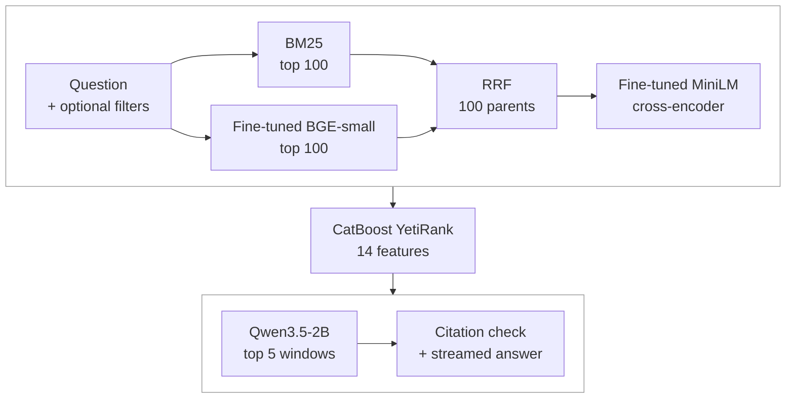

# Ledgerlight

Retrieval-augmented question answering over the public SEC filings of 22 U.S. companies. Hybrid retrieval and a learned ranker select the evidence, and a local Qwen3.5-2B model writes a short answer that cites it. If the passages don't support an answer, or the answer cites none of them, no answer is shown.

**Result:** on held-out TEST questions, the full ranking pipeline reaches nDCG@10 of 38.58%, against 22.79% for BM25 (+15.79 points, 95% CI 10.27 to 21.44; see [How to read the results](#how-to-read-the-results)).

**Demo:** <https://ledgerlight.flaretensor.uk> (online while the stack is running)

## Pipeline



Each step is described in [How a question is answered](#how-a-question-is-answered).

## Stack

- **Retrieval and models:** `bm25s`, Qdrant, PyTorch, CatBoost, llama.cpp, `ranx`, Optuna.
- **Serving:** FastAPI, Streamlit, Triton Inference Server with ONNX Runtime by default, PyTorch and OpenVINO backends, Docker Compose.
- **MLOps:** MLflow with PostgreSQL, a DVC pipeline definition, Prometheus, Grafana, Locust.
- **Tooling:** Python 3.12, `uv`, Ruff, pytest, GitHub Actions, Cloudflare Tunnel.

## Data

The passages come from [FinRank](https://github.com/datanxt/FinRank/tree/916dc27e77b90e294ea1b3a2cc5b0abcf07392d1) ([paper](https://arxiv.org/abs/2608.07400)): 5,230 curated excerpts from the 10-K and 10-Q filings of 22 energy, healthcare and automotive companies. Each passage carries one or more source records with ticker, form type, filing year and page.

FinRank also has 1,185 questions written by trained annotators, with passage-level relevance labels. Ledgerlight uses the dataset's own random split: 948 TRAIN, 118 DEV and 119 TEST questions.

## Passages and windows

The pipeline works with two units.

- **Passage.** One of the 5,230 FinRank excerpts. Relevance labels, rankings and the sources shown in the interface all refer to passages.
- **Window.** A piece of a passage, at most 448 tokens long. The dense encoder and the cross-encoder read windows.

Passages longer than 448 tokens are cut into overlapping windows with a step of 320 tokens; a shorter passage forms a single window. 3,246 of the 5,230 passages are longer than the encoder's 512-token limit. The cutting yields 12,604 windows in total. Window boundaries follow character offsets in the original text, so figures like `$31.9 billion` reach the models exactly as written. The 448-token size leaves room for the question in the cross-encoder's 512-token input.

A passage's best window is the window whose embedding is closest to the question. The cross-encoder and the language model read this window.

## How a question is answered

| Step | Reads | Produces |
| --- | --- | --- |
| 1. Filters | Optional company, form type (10-K or 10-Q) and filing year chosen by the user, and the source records of each passage. The filter values never come from the relevance labels. | The passages with at least one source record that matches every chosen filter. Filtering happens before retrieval. |
| 2. BM25 (`bm25s`) | The question and the full text of each remaining passage. | The 100 highest-scoring passages. |
| 3. Dense retrieval (fine-tuned `bge-small-en-v1.5`, Qdrant) | The question and the 384-dimensional vector of every window. A passage scores as its best window. | The 100 highest-scoring passages. |
| 4. Fusion (reciprocal rank fusion, k = 10) | The two lists of 100 passages. | The 100 best passages of the merged ranking. |
| 5. Cross-encoder (fine-tuned MiniLM-L6) | The question paired with the best window of each of the 100 passages. | One relevance score per passage. |
| 6. Ranking (CatBoost YetiRank) | 14 features per passage: the BM25, dense, fusion and cross-encoder scores and ranks; passage length in tokens; window count; question length; and whether the question's ticker, year and form match the passage metadata. | The final order of the 100 passages. |
| 7. Generation (Qwen3.5-2B, Q4_K_M GGUF, llama.cpp) | The question and the best window of each of the top five passages, each labeled with a source marker and its ticker, form type, filing year and page. Context: 8,192 tokens, thinking budget: 512 tokens, generation limit: 1,024 tokens. | An answer with source markers. |
| 8. Validation (gateway) | The generated answer. | Numbered citations for valid source markers; invented markers, URLs and HTML are rejected. The answer streams as it is generated, and the model's reasoning stays hidden. |

## Evaluation

- TRAIN is split into 712 questions for the neural models and 236 for the ranker, so the ranker learns from scores the neural models didn't train on.
- DEV picks every setting: 6 Optuna trials for the encoder and 6 for the cross-encoder (each trial fine-tunes a model on the GPU), and 50 for CatBoost.
- TEST was scored once, after every choice was frozen on DEV. The evaluation script refuses to score it again.
- Metrics are averaged over questions. Confidence intervals come from a paired bootstrap over questions (10,000 resamples, seed 42).

## Results

TEST, 119 questions, all values in percent. The last column is DEV nDCG@10, for comparison.

| Method | Recall@10 | Recall@100 | MRR | nDCG@10 | DEV nDCG@10 |
| --- | --- | --- | --- | --- | --- |
| BM25 | 37.04 | 65.62 | 22.97 | 22.79 | 24.18 |
| BGE, pretrained | 33.40 | 67.37 | 19.81 | 19.96 | 23.57 |
| BM25 + BGE, fused | 41.25 | 70.03 | 22.96 | 24.43 | 27.32 |
| BM25 + BGE, fused, pretrained cross-encoder | 39.22 | 70.03 | 26.75 | 25.02 | 26.89 |
| BGE, fine-tuned | 43.98 | 73.39 | 30.38 | 28.96 | 32.57 |
| BM25 + fine-tuned BGE, fused | 49.51 | 73.32 | 30.41 | 31.23 | 32.19 |
| The same with the pretrained cross-encoder | 42.58 | 73.32 | 29.07 | 27.17 | 30.21 |
| The same with the fine-tuned cross-encoder | 51.89 | 73.32 | 34.02 | 33.79 | 34.77 |
| Fine-tuned cross-encoder and CatBoost ranker (selected) | 55.25 | 73.32 | 38.06 | 38.58 | 43.67 |

Paired differences in TEST nDCG@10, in points, with 95% confidence intervals:

| Comparison | Difference | 95% CI |
| --- | --- | --- |
| Selected pipeline vs. BM25 | +15.79 | 10.27 to 21.44 |
| CatBoost ranker vs. fine-tuned cross-encoder | +4.79 | 1.57 to 8.18 |
| Fine-tuned vs. pretrained cross-encoder | +6.62 | 3.06 to 10.46 |
| Fine-tuned vs. pretrained BGE, dense only | +9.00 | 5.25 to 12.93 |

Only the comparison with BM25 was planned before TEST was scored. The other comparisons and the analyses below were computed afterward from the saved rankings.

- **DEV vs. TEST.** The selected pipeline scores 43.67% on DEV and 38.58% on TEST. DEV was used for selection, so TEST is the figure to rely on.
- **Candidate coverage.** Recall@100 of 73.32% caps what any reranker can reach. For 22 of the 119 TEST questions, no labeled passage is among the 100 candidates. For 27, one is among them but not in the top five. For 70, at least one is in the five passages sent to the LLM.
- **Feature groups.** On DEV, retraining the ranker without one feature group lowers nDCG@10 by 5.51 points without the metadata matches (CI 2.62 to 8.69), 5.26 without the first-stage scores (2.05 to 8.42) and 3.94 without the cross-encoder scores (0.98 to 7.02). Without the length features it drops 2.67 points, with an interval that includes zero.
- **Larger encoder.** `bge-large-en-v1.5`, used as published, reaches 24.54% (dense) and 25.44% (fused) TEST nDCG@10. The fine-tuned small encoder is 4.42 points ahead of the dense figure, with an interval that includes zero (−0.84 to 9.55). The full pipeline is 13.14 points ahead of the fused large-encoder baseline (7.58 to 19.02).
- **Known passages.** For 70 of the 119 TEST questions (78 with normalized text matching), a relevant passage is also labeled relevant for some TRAIN question. The gain over BM25 is 12.98 points on those 70 and 19.81 on the other 49, so it is positive in both groups.

## How to read the results

- **Retrieval metrics.** nDCG, Recall and MRR measure how high the labeled passages rank. The quality of generated answers was not evaluated; the FinRank authors also leave answer evaluation to future work. The gateway checks that each citation marker refers to a retrieved passage. Whether that passage supports the statement, or whether a figure is right, was not checked. Of the 88 cited DEV answers, 40 cite at least one passage labeled relevant.
- **Incomplete labels.** One annotator wrote the gold passages for each question, and a passage can be relevant to more than one question (see §3.7 and §9 of the [paper](https://arxiv.org/abs/2608.07400)). Passages that nobody judged count as non-relevant in every metric and in the ranker's training targets, except whitespace-equivalent copies of known positives, which are excluded from the targets.
- **One corpus for all splits.** The TEST questions are new, and the passage pool is shared with training. The results therefore say nothing about unseen documents, other companies or other periods.
- **Filing year.** The year metadata is the filing year, sometimes imputed by the dataset authors. A question about fiscal 2024 is often answered by a 2025 filing, so a year filter can hide the right passage.

## Serving

Reference device: Intel Core i5-12500H, 64 GB RAM, NVIDIA RTX 3050 Laptop GPU with 4 GB of memory. The encoder and cross-encoder run on five backends without retraining. Latency is search p95 over the 118 DEV questions. Peak memory is total GPU use while the LLM, fully on the GPU, answers eight questions.

| Search backend | Search p95, s | Peak GPU memory, MiB | Status |
| --- | --- | --- | --- |
| Triton Inference Server, ONNX Runtime | 0.911 | 2,424 | default |
| PyTorch | 0.944 | 3,130 | available |
| OpenVINO on CPU | 5.359 | 1,461 | available; used by the CPU mode |
| ONNX Runtime CUDA, in process | not completed | 2,626 | excluded: ran out of GPU memory |

Every backend reproduces the PyTorch scores within 1e-4 and the DEV nDCG@10 within 0.005. In-process ONNX Runtime ran out of CUDA memory partway through the 118-question pass while sharing the GPU with the LLM, so it is excluded. Triton with the OpenVINO backend also runs but is not the default.

With the default backend, replaying the 118 DEV questions one at a time through the streaming endpoint gave 118 answers with no errors or timeouts: 88 with citations and 30 abstentions. The first text appeared after 7.3 s (median) and 7.5 s (p95), observed in 102 of the 118 requests. The full answer took 9.7 s (median) and 19.9 s (p95).

**CPU mode.** `--cpu` runs retrieval on OpenVINO and the LLM entirely on the CPU, leaving the GPU free. One measured answer took 57.6 s, with the first text after 43.8 s.

**Registry and monitoring.** MLflow registers all nine pipeline variants. The stack loads the `champion` alias and keeps a `previous` alias; switching to `previous` and back has been exercised end to end. Prometheus and a Grafana dashboard track request outcomes, queue depth, stage latencies and time to first text.

## Running it

Requirements: Python 3.12, uv and Docker Compose. GPU serving needs an NVIDIA GPU and the NVIDIA container runtime. CPU mode runs without a GPU.

### Setup

```sh
source scripts/env.sh
uv sync --frozen
cp .env.example .env    # then set local database and Grafana passwords
docker compose --profile triton pull --ignore-buildable
```

### Models

The trained weights are published on [Hugging Face](https://huggingface.co/flaretensor/ledgerlight-models) as a model bundle of 25 files (674 MB): the fine-tuned encoder, cross-encoder and ranker with tokenizers and configs, their ONNX exports, `SHA256SUMS` and `provenance.json`. The bootstrap command verifies the checksums, downloads the pinned FinRank file and the pinned Qwen GGUF, and rebuilds the windows, the BM25 and Qdrant indexes and the registry:

```sh
python scripts/release_models.py bootstrap --repo flaretensor/ledgerlight-models --revision b016486e02dc34324dcbe7be594c9bd2d2f5b732
# or, from a local copy of the bundle:
python scripts/release_models.py bootstrap --bundle PATH
```

On the reference device, the bootstrap took 14 to 16 minutes with downloads already cached.

### Start and stop

```sh
python scripts/site.py start          # default backend, LLM on the GPU
python scripts/site.py start --cpu    # CPU only, no GPU needed
python scripts/site.py status
python scripts/site.py stop
```

The page is served at `http://127.0.0.1:8501`. A cold start takes about a minute and a half. Stop the stack before switching modes. `start --public` also starts a Cloudflare Tunnel container, which needs a token file at `.secrets/cloudflared/token`.

### Training and checks

```sh
python -m ledgerlight.data ingest      # download the pinned dataset
python -m ledgerlight.data validate
bash scripts/train.sh                  # resumable training, DEV selection, registration
bash scripts/ci.sh                     # lint, format, tests, leakage checks, synthetic CPU pipeline
```

Training took about two and a half hours on the reference device. `dvc.yaml` also declares the stages from data ingestion to DEV evaluation as a DVC pipeline.

Training uses fixed seeds. GPU training is not bit-for-bit deterministic, so a new run can differ slightly from the published weights.

GitHub Actions runs `scripts/ci.sh` on every push (no GPU or Docker needed). `scripts/checks/` holds the scripts behind the serving measurements and the larger-encoder comparison.

## License

Code is licensed under [Apache-2.0](LICENSE).

The FinRank annotations are CC BY-NC 4.0 and are not redistributed here; the pinned commit `916dc27e77b90e294ea1b3a2cc5b0abcf07392d1` is downloaded and checked against a SHA256. The underlying SEC filings carry a separate license. The trained weights are published at [flaretensor/ledgerlight-models](https://huggingface.co/flaretensor/ledgerlight-models) and carry CC BY-NC 4.0 metadata because they were trained on those annotations.

Base models keep their own licenses: `BAAI/bge-small-en-v1.5` (MIT), `cross-encoder/ms-marco-MiniLM-L6-v2` (Apache-2.0) and Qwen3.5-2B (Apache-2.0).
