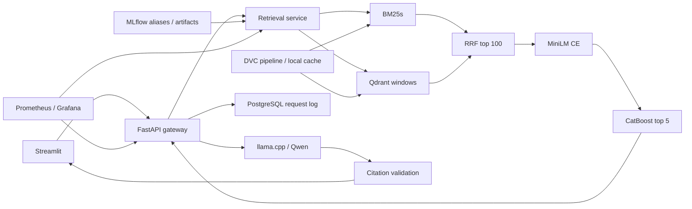

# Ledgerlight

Ledgerlight is a local English finance-document RAG application: hybrid passage retrieval, learned reranking, and Qwen answers with numbered citations. The Ask tab shows answers with expandable sources, or “No answer found in the indexed passages.” on abstention; filter by ticker, year, and filing form. The How it was ranked tab opens with full retrieved-passage expanders, followed by a scrolling candidate table sorted by LTR rank with sent-to-model and cited flags; retrieval timings use milliseconds, while gateway end-to-end and generation times use seconds. Citation markers are structural membership checks and do not guarantee that answer wording or numbers match the source. Year labels in the dataset are not normalized to filing or fiscal year, so the year filter can exclude passages that discuss that year.

**Results at a glance**

- Frozen Torch TEST nDCG@10: BM25 **22.79% → CatBoost 34.92%**, **+12.13 pp**, paired-bootstrap 95% CI **[6.71, 17.65]**.
- Official evaluation: **119 TEST / 118 DEV** questions in a known-document/new-query setting.
- Configuration selection compared many candidates on DEV; those DEV results are optimistically biased by selection.
- Live serving uses **ORT CUDA**; the current-prompt 119-question replay records ORT CUDA in every response. The frozen TEST retrieval ladder remains Torch; ORT retrieval-metric parity was validated on DEV only.


## Architecture



Window hits are grouped by passage using maximum cosine similarity. Production Qdrant retrieval remains exact. Filters match one provenance record, so a ticker from one source cannot combine with a year from another. The query contract accepts question text and optional filters; labels and gold answers are unavailable to serving.

The gateway serializes generation, supplies the best window of each of five passages, issues per-request source markers, and logs candidates, scores, answers, citations, timings, versions, and failures to PostgreSQL. Citation rendering rejects unissued markers, generated URLs, HTML, and uncited output. Marker membership is not entailment or a guarantee that a citation supports every claim.

Triton is an isolated ONNX experiment, outside the RAG request path. On a 4 GiB GPU, stop application GPU services before benchmarks or Triton.

## Run locally

Prerequisites are Docker with NVIDIA container access, uv, and the retained local artifacts or a separately reproduced workspace. Run commands from the repository root in Bash. All application ports bind to loopback; Compose uses `restart: "no"` and no autostart.

```bash
source scripts/env.sh
ledgerlight start
ledgerlight health
ledgerlight ask "(example question omitted)"
ledgerlight stop
```

`start` builds the local application image as needed and waits for gateway/UI health. `stop` sends SIGTERM, waits up to 60 seconds without sending SIGKILL, and stops PostgreSQL last. It preserves data, volumes, containers, images, and caches.

After a cold reboot, check the data mount before starting Docker. You start Docker with the host administrator command below; project scripts do not manage the daemon.

```bash
findmnt .
sudo systemctl start docker
source scripts/env.sh
docker info --format '{{.DockerRootDir}}'
nvidia-smi
docker compose up -d --wait postgres
docker compose exec -T postgres pg_isready -h 127.0.0.1 -p 5433 -U ledgerlight
docker compose up -d --wait mlflow qdrant prometheus grafana
curl --fail http://127.0.0.1:5000/health
curl --fail http://127.0.0.1:6333/healthz
ledgerlight start
ledgerlight health
```

PostgreSQL listens on **5433 inside and outside the container**. If the mount or daemon checks fail, resolve host readiness before starting project services. Persistent store identifiers retain their original names; see [build notes](docs/BUILD_LOG.md#internal-identifiers-kept-for-store-continuity).

| Service | Loopback address |
|---|---|
| UI | http://127.0.0.1:8501 |
| Gateway / schema | http://127.0.0.1:8000/health , http://127.0.0.1:8000/docs |
| Retrieval | http://127.0.0.1:8001/health |
| MLflow | http://127.0.0.1:5000 |
| PostgreSQL | 127.0.0.1:5433 |
| Qdrant | http://127.0.0.1:6333 |
| llama.cpp | http://127.0.0.1:8091/health |
| Prometheus | http://127.0.0.1:9090 |
| Grafana | http://127.0.0.1:3000/d/ledgerlight-runtime/ledgerlight-runtime |
| Optional Triton | HTTP 8002, gRPC 8003, metrics 8004 on 127.0.0.1 |

## Data and reproduction

FinRank is acquired from [datanxt/FinRank at the pinned revision](https://github.com/datanxt/FinRank/tree/916dc27e77b90e294ea1b3a2cc5b0abcf07392d1). The dataset is **CC BY-NC 4.0 and not bundled in Git**. Acquisition verifies 34,129,228 bytes and SHA256 `e9295f680bd6085362486c90c170bce243be7f85ed18074d6ba21cb75141ac78`.

The pool contains 1,185 queries and **5,230 exact-text passages**, 4,796 after whitespace normalization. It is not all of EDGAR or a complete filing archive. The official random split is 948 TRAIN / 118 DEV / 119 TEST. Available source fields are ticker, year, form, and page; full company names and source URLs are absent.

A direct provenance recount finds **174 passages with multiple distinct (ticker, year, form, page) records**: 440 records across those passages, 5,496 records overall, and 266 records beyond one per passage. Within the pool, **46 passages** have multiple distinct (ticker, year, form) combinations. These are passage counts, not a claim that there are only 174 metadata combinations. [Recount and proxy calculations](reports/docs_facts.json) retain the units.

Other known data quirks are preserved: 538 hard-negative occurrences match positives for other queries, 19 stored SHA1 mismatches under the stripped-text comparison, three repeated normalized question groups, and one question repeated across TRAIN and TEST with different positives. Negatives remain query-specific. This protocol measures known-document/new-query retrieval, not unseen-document transfer.

```bash
source scripts/env.sh
dvc status
LEDGERLIGHT_RESUME=1 dvc repro evaluate
python scripts/leakage_check.py
bash scripts/ci.sh
```

The official DAG is ingest → validate → index_bm25 → embed → baselines → train → evaluate. Unchanged outputs are reused. The evaluator reuses the frozen TEST result when its training fingerprint matches and refuses changed training inputs. Preserve frozen outputs; new diagnostics belong in separate files. DVC lock metadata was refreshed during renaming without executing official stages or changing any of the 15 tracked output hashes.

For a fresh workspace, `bash scripts/bootstrap.sh` creates the environment and private `.env`, acquires pinned artifacts, reproduces the pipeline, registers models, and starts services. **This fresh bootstrap path has not been rerun end to end.** It includes substantial downloads and training; it is not a restart command. No DVC remote is configured, so a fresh Git checkout alone cannot retrieve unpublished local checkpoints. Caches and temporary paths are scoped by `scripts/env.sh`; the storage guard requires 20 GiB free on both filesystems.

## Models and training

BGE uses normalized CLS embeddings, the model-card query prefix, 510 content tokens plus specials, stride 384, and 11,067 windows. BM25s uses Lucene IDF, k1=1.5, b=0.75, and lowercase `\w+` tokens. DEV selected RRF k=10 from 10/30/60/100 and CE depth 50 from 20/50/100. CE scores one best dense window per passage; CatBoost uses RRF top-100 candidates with CE features for that pool.

| Component | Pin |
|---|---|
| BGE | `BAAI/bge-small-en-v1.5` @ `5c38ec7c405ec4b44b94cc5a9bb96e735b38267a` |
| CE | `cross-encoder/ms-marco-MiniLM-L6-v2` @ `233902d25c440f23af6f7d6e94d2946bac0bee0a` |
| GGUF | `unsloth/Qwen3.5-2B-GGUF` @ `f6d5376be1edb4d416d56da11e5397a961aca8ae`, Q4_K_M |
| GGUF digest | `aaf42c8b7c3cab2bf3d69c355048d4a0ee9973d48f16c731c0520ee914699223` |
| llama.cpp | CUDA 12.8 build `b12284`; archive digest in `services.lock.json` |

Normalized-question groups divide TRAIN into A (712 queries, neural training) and B (236 queries, LTR). Six BGE and six CE configurations completed; CatBoost used 50 Optuna trials. Selected configurations and seed results remain in DVC and PostgreSQL-backed MLflow. No personal annotation or LLM judge is used.

The 14 LTR features are lexical/dense/RRF/CE scores and their four ranks; passage token length, window count, question word count; and ticker/year/form matches parsed from question text against passage metadata. No qrels, answers, train-positive popularity, or “was positive in training” priors enter query-time features. The leakage audit checks partition membership, serialized feature names, and poisoned-oracle invariance.

## Frozen Torch retrieval evaluation

The nine-entry frozen retrieval ladder used **Torch**. The current-prompt 119-question citation replay used **ORT CUDA**; the earlier prompt run used Torch. ORT retrieval-metric parity validation remains DEV-only. Recall is macro-averaged labeled-positive recall per query; all values below are percentages.

DEV, n=118:

| Configuration | R@10 | R@20 | R@100 | nDCG@10 | MRR |
|---|---:|---:|---:|---:|---:|
| BM25 | 36.02 | 45.55 | 65.54 | 24.18 | 26.32 |
| BGE | 39.19 | 51.20 | 72.95 | 25.38 | 27.73 |
| RRF | 42.87 | 50.99 | 73.66 | 28.62 | 30.62 |
| CE-zero | 41.45 | 54.66 | 73.66 | 28.32 | 31.36 |
| BGE-ft+RRF+CE-zero | 43.50 | 55.51 | 81.29 | 29.48 | 32.42 |
| CE-ft | 52.05 | 63.42 | 81.29 | 33.86 | 33.90 |
| CatBoost | 59.39 | 69.99 | 81.29 | 40.26 | 42.85 |
| BGE-ft-dense | 47.74 | 63.70 | 80.65 | 31.31 | 33.73 |
| RRF-ft | 46.12 | 59.89 | 81.29 | 31.78 | 34.68 |

Frozen TEST, n=119:

| Configuration | R@10 | R@20 | R@100 | nDCG@10 | MRR |
|---|---:|---:|---:|---:|---:|
| BM25 | 37.04 | 44.61 | 65.62 | 22.79 | 22.97 |
| BGE | 33.68 | 48.67 | 66.04 | 21.53 | 22.78 |
| RRF | 42.93 | 53.29 | 70.31 | 25.37 | 24.54 |
| CE-zero | 41.32 | 51.12 | 70.31 | 25.50 | 26.66 |
| BGE-ft+RRF+CE-zero | 42.16 | 53.50 | 74.09 | 26.19 | 26.87 |
| CE-ft | 48.25 | 57.84 | 74.09 | 28.47 | 26.52 |
| CatBoost | 52.45 | 60.85 | 74.09 | 34.92 | 36.15 |
| BGE-ft-dense | 47.13 | 55.46 | 74.09 | 28.87 | 29.03 |
| RRF-ft | 46.99 | 60.50 | 74.09 | 29.78 | 30.12 |

`BGE-ft+RRF+CE-zero` is the ladder stage with tuned BGE, RRF, and zero-shot CE. `BGE-ft-dense` is the tuned dense-only alternative; `RRF-ft` omits CE. The stored frozen artifact labels remain unchanged.

CatBoost minus BM25 nDCG@10 is **+12.13 pp, paired-bootstrap 95% CI [6.71, 17.65]**, using 10,000 query resamples and seed 42. TEST n=119 leaves substantial uncertainty. Selection among many candidates on only 118 DEV questions makes DEV optimistic. **40.26% is the CatBoost seed-42 result and the maximum of three seeds; mean 39.82%, range 39.11–40.26%.**

The learned-reranker entries share **TEST R@100 74.09% / DEV R@100 81.29%**. Roughly a quarter of labeled positives per TEST question never reach these rerankers on average; reranking cannot recover missing candidates.

Negative results remain visible: zero-shot CE reduced DEV nDCG relative to RRF, including tuned RRF. CE fine-tuning improved its direct predecessor, but its TEST nDCG was below tuned dense/RRF alternatives. CatBoost remains selected on DEV; no TEST comparison changed selection. A single DEV rank-bm25 diagnostic attributed baseline differences to the BM25/IDF variant. Results, per-query metrics, and the original paired bootstrap are retained in `data/evaluation/` and the `frozen-ladder` run.

## Citation and latency proxies

The saved current-prompt ORT CUDA `/ask` replay contains 119 completed TEST requests, no HTTP failures, and these **operational/citation proxies—not answer correctness**:

| Measure | Result |
|---|---:|
| Accepted citation present | 50/119, 42.02% |
| At least one qrel-positive citation | 16/119, 13.45% |
| Abstention | 69/119, 57.98% |
| Completion limit / no-thinking retry | 32/119, 26.89% |
| E2E p50 / p95 | 9.81 / 21.20 s |
| E2E mean | 11.85 s |

These proxies use the current prompt; the previous-prompt Torch run gave similar aggregate values compatible with single-run noise, whose magnitude was not measured; no improvement or degradation is established, and differences cannot be attributed to the prompt because the backend also changed.

Among the 50 cited answers, **16/50 = 32.00%** cited a labeled-positive passage. This is a lower-bound qrel-membership proxy because qrels are incomplete. It is not a lower bound on answer correctness or entailment.

Qwen uses context 8192, thinking budget 512, and total completion cap 1024. DEV probes observed 511 retokenized reasoning tokens at the template boundary; the runtime did not expose an authoritative reasoning-token counter. The gateway retries once without thinking on truncation. The current replay retried 32/119 requests (26.89%); the cause of completion-limit retries, including any role of verbosity, is not established. Serving is essentially single-user on the 4 GiB GPU because generation is serialized.

A separate previous-prompt six-request, single-question DEV streaming probe measured process-cold TTFT 0.611 s, warm TTFT p50/p95 0.606/0.610 s, first-answer-token p50/p95 5.696/5.715 s, median decode 100.98 tokens/s, and sampled VRAM peak 3120 MiB. This is LLM-only TTFT, includes reasoning, uses warm OS page cache, and is not `/ask` TTFT or a capacity claim.

## Serving experiments and observability

The ONNX comparison used FP32, opset 17, 512 real financial tokens, eight CPU threads, three warmups and 20 repetitions. Transfer is included and tokenization excluded. Median milliseconds:

| Model / batch | Torch CPU | ORT CPU | Torch CUDA | ORT CUDA |
|---|---:|---:|---:|---:|
| BGE / 1 | 135.59 | 76.10 | 17.06 | 15.43 |
| BGE / 8 | 1437.32 | 703.39 | 128.88 | 118.33 |
| CE / 1 | 70.84 | 42.56 | 9.49 | 7.85 |
| CE / 8 | 780.51 | 365.05 | 64.71 | 59.40 |

Full DEV aggregate retrieval metrics matched Torch on ORT CPU and CUDA. CPU exact top-20 order matched 118/118 queries, CUDA 117/118, both with 100% top-20 set overlap against the frozen window index. The separate live ORT CUDA check matched 19/20 exact orders and 99.75% top-20 overlap, with matching cutoff metrics. Serving is not bit-exact. CE is capped at batch 8 after a retained 1 GiB arena failure at batch 32; details are in the [build log](docs/BUILD_LOG.md).

Isolated Triton 26.01 ONNX validation passed parity. For each model, 32 concurrent batch-1 requests became five executions, mean batch 6.4, with total GPU memory 1773 MiB after the run. HTTP p50/p95 milliseconds were BGE batch 1: 18.34/20.09, batch 8: 118.45/119.51; CE batch 1: 10.30/10.64, batch 8: 60.20/60.34. HTTP round trips differ from model-only timings. Triton is not in the RAG path; TensorRT was not attempted.

On 25 DEV query vectors, Qdrant unfiltered approximate top-20 overlap with exact search was 99.6%, with median exact/approximate latency 4.27/2.71 ms at ef=64. Selective payload filters may cause the planner to use full scans. Production stays exact. Optional pgvector HNSW was slower and less complete under selective filters: for JNJ/2025, exact/HNSW median 7.10/24.68 ms and overlap 96.4%. These are agreement/latency measurements, not relevance or correctness.

Prometheus and a provisioned ten-panel Grafana dashboard expose request rate, E2E and per-stage latency, errors, abstention, CPU, RSS, GPU memory, and scrape availability. Gateway, retrieval, Qdrant, llama.cpp, and isolated Triton were scraped while active in separate GPU phases. SQL failure slices are in `sql/`.

The previous-prompt Locust DEV sanity run offered one process-cold request and 12 warm requests at 0.1 requests/s: **13 completed, zero failed**. Cold E2E was 8.407 s; warm p50/p95 **20.12/24.44 s**, with four no-thinking retries. Queue p50/p95 was 8.617/13.641 s. The observed drain-inclusive completion rate was 0.0894/s over 134.238 s. This small run is **not a throughput or capacity benchmark or an SLA claim**. Cold excludes startup and retains warm OS page cache.

Evidence and exact protocols are in `data/serving/{backends,triton,vector_search,pgvector,load,observability,sql_slices}.json`. Stop application GPU services before rerunning GPU experiments:

```bash
source scripts/env.sh
docker compose stop --timeout 30 llama retrieval
python scripts/backend_check.py
CUDA_VISIBLE_DEVICES='' python scripts/export_components.py
python scripts/prepare_triton.py
docker compose -f compose.yaml -f compose.triton.yaml --profile triton up -d triton
CUDA_VISIBLE_DEVICES='' python scripts/triton_check.py
docker compose -f compose.yaml -f compose.triton.yaml --profile triton stop --timeout 30 triton
ledgerlight start
```

## Registry and local lifecycle

Registry metadata identifies these pipeline versions:

| Version | Configuration identified by method tag |
|---|---|
| 1 | BM25 baseline |
| 2 | BGE |
| 3 | RRF |
| 4 | CE-zero |
| 5 | BGE-ft+RRF+CE-zero |
| 6 | CE-ft |
| 7 | CatBoost, champion |
| 8 | BGE-ft-dense |
| 9 | RRF-ft |

| Component version | Identification in registration run metadata |
|---|---|
| Encoder 1 | Base registration, `register-encoder-base` |
| Encoder 2 | Trained registration, `register-encoder-trained` |
| CE 1 | Base registration, `register-cross-encoder-base` |
| CE 2 | Trained registration, `register-cross-encoder-trained` |
| Ranker 1 | Ranker registration, `register-ranker`; referenced by pipeline 7 |

Exact training trial IDs are **not identified in registry metadata** for the component versions. Checkpoint selections are recorded separately in `data/training/*_selected.json`. [Registry baseline metadata](reports/rename/baseline.json) preserves the identification evidence.

Pipeline champion is 7 and previous is 1. Promotion through `ledgerlight promote VERSION` requires a finite full-pipeline DEV nDCG@10 at least as high as the champion and preserves the prior alias. `ledgerlight rollback` restores the previous version. The saved local demonstration served versions 1 → 7 → 1 → 7 and rejected a regression; receipts are in `data/serving/lifecycle.json`. Historical pyfunc imports use a small compatibility namespace documented in the build log; artifacts and aliases are unchanged.

`bash scripts/ci.sh` runs Ruff, formatting, pytest, a static forbidden-feature gate, and an eight-query/sixteen-passage CPU DVC fixture. The local rehearsal passes 11 tests with four nonblocking MLflow type-hint warnings. **Hosted GitHub Actions has not run.** This is a local lifecycle rehearsal, not production MLOps or a claim to Google MLOps level 1 or 2.

## Third-party components and licenses

The following records reproduce declarations in pinned model cards, source licenses, or installed distribution metadata. They are not legal conclusions or a complete transitive-license review. **The code license is not yet specified.** FinRank remains CC BY-NC 4.0 and is acquired separately, not bundled.

| Component | Declared license / scope | Primary source |
|---|---|---|
| BGE-small, pinned revision above | MIT | [pinned model metadata](https://huggingface.co/BAAI/bge-small-en-v1.5/blob/5c38ec7c405ec4b44b94cc5a9bb96e735b38267a/README.md) |
| MiniLM CE, pinned revision above | Apache-2.0 | [pinned model metadata](https://huggingface.co/cross-encoder/ms-marco-MiniLM-L6-v2/blob/233902d25c440f23af6f7d6e94d2946bac0bee0a/README.md) |
| Unsloth Qwen GGUF, pinned revision above | Apache-2.0 | [pinned conversion metadata](https://huggingface.co/unsloth/Qwen3.5-2B-GGUF/blob/f6d5376be1edb4d416d56da11e5397a961aca8ae/README.md) |
| Upstream Qwen/Qwen3.5-2B | Apache-2.0 at inspected commit `15852e8c16360a2fea060d615a32b45270f8a8fc`; exact upstream commit used for GGUF is not verified | [upstream metadata](https://huggingface.co/Qwen/Qwen3.5-2B/blob/15852e8c16360a2fea060d615a32b45270f8a8fc/README.md) |
| llama.cpp b12284 | MIT | [pinned LICENSE](https://github.com/ggml-org/llama.cpp/blob/b12284/LICENSE) |
| Qdrant 1.20.0 | Apache-2.0 | [pinned LICENSE](https://github.com/qdrant/qdrant/blob/v1.20.0/LICENSE) |
| Triton 26.01-py3 | Bundled server LICENSE: BSD-3-Clause; complete image/bundled terms **not verified** | [server source LICENSE](https://github.com/triton-inference-server/server/blob/r26.01/LICENSE), retained image inspection |
| Prometheus 3.16.0 | Apache-2.0 | [pinned LICENSE](https://github.com/prometheus/prometheus/blob/v3.16.0/LICENSE) |
| Grafana 13.3.1 | GNU AGPL version 3 | [pinned LICENSE](https://github.com/grafana/grafana/blob/v13.3.1/LICENSE) |
| PostgreSQL 18.6 / pgvector 0.8.7 | PostgreSQL License (terms in the respective COPYRIGHT / LICENSE files) | [PostgreSQL](https://github.com/postgres/postgres/blob/REL_18_6/COPYRIGHT), [pgvector](https://github.com/pgvector/pgvector/blob/v0.8.7/LICENSE) |
| Ubuntu base / uv builder and other bundled runtime components | Complete image terms **not verified** | Component-wide review remains incomplete |

Direct Python requirements and development tools, at the locked installed versions:

| Package | Version | Declared license | Versioned primary metadata |
|---|---|---|---|
| typer | 0.29.1 | MIT | [metadata](https://pypi.org/project/typer/0.29.1/) |
| pydantic | 2.14.3 | MIT | [metadata](https://pypi.org/project/pydantic/2.14.3/) |
| pyyaml | 6.0.3 | MIT | [metadata](https://pypi.org/project/pyyaml/6.0.3/) |
| numpy | 2.5.4 | BSD-3-Clause | [metadata](https://pypi.org/project/numpy/2.5.4/) |
| pandas | 2.3.3 | BSD-3-Clause | [metadata](https://pypi.org/project/pandas/2.3.3/) |
| pandera | 0.27.1 | MIT | [metadata](https://pypi.org/project/pandera/0.27.1/) |
| bm25s | 0.2.14 | MIT | [metadata](https://pypi.org/project/bm25s/0.2.14/) |
| ranx | 0.3.21 | MIT | [metadata](https://pypi.org/project/ranx/0.3.21/) |
| rank-bm25 | 0.2.2 | Apache-2.0 | [metadata](https://pypi.org/project/rank-bm25/0.2.2/) |
| torch | 2.8.0+cu128 | BSD-3-Clause | [metadata](https://pypi.org/project/torch/2.8.0+cu128/) |
| sentence-transformers | 5.2.3 | Apache-2.0 | [metadata](https://pypi.org/project/sentence-transformers/5.2.3/) |
| transformers | 4.57.6 | Apache-2.0 | [metadata](https://pypi.org/project/transformers/4.57.6/) |
| datasets | 4.8.5 | Apache-2.0 | [metadata](https://pypi.org/project/datasets/4.8.5/) |
| accelerate | 1.15.0 | Apache-2.0 | [metadata](https://pypi.org/project/accelerate/1.15.0/) |
| catboost | 1.2.10 | Apache-2.0 | [metadata](https://pypi.org/project/catboost/1.2.10/) |
| optuna | 4.9.0 | MIT | [metadata](https://pypi.org/project/optuna/4.9.0/) |
| mlflow | 3.7.0 | Apache-2.0 | [metadata](https://pypi.org/project/mlflow/3.7.0/) |
| dvc | 3.67.1 | Apache-2.0 | [metadata](https://pypi.org/project/dvc/3.67.1/) |
| psycopg | 3.3.8 | LGPL-3.0-only | [metadata](https://pypi.org/project/psycopg/3.3.8/) |
| psycopg2-binary | 2.9.13 | LGPL with exceptions | [metadata](https://pypi.org/project/psycopg2-binary/2.9.13/) |
| qdrant-client | 1.20.0 | Apache-2.0 | [metadata](https://pypi.org/project/qdrant-client/1.20.0/) |
| fastapi | 0.162.4 | MIT | [metadata](https://pypi.org/project/fastapi/0.162.4/) |
| uvicorn | 0.54.0 | BSD-3-Clause | [metadata](https://pypi.org/project/uvicorn/0.54.0/) |
| httpx | 0.28.1 | BSD-3-Clause | [metadata](https://pypi.org/project/httpx/0.28.1/) |
| streamlit | 1.67.0 | Apache-2.0 | [metadata](https://pypi.org/project/streamlit/1.67.0/) |
| prometheus-client | 0.26.0 | Apache-2.0 | [metadata](https://pypi.org/project/prometheus-client/0.26.0/) |
| locust | 2.47.0 | MIT | [metadata](https://pypi.org/project/locust/2.47.0/) |
| onnx | 1.23.2 | Apache-2.0 | [metadata](https://pypi.org/project/onnx/1.23.2/) |
| onnxruntime-gpu | 1.23.2 | MIT | [metadata](https://pypi.org/project/onnxruntime-gpu/1.23.2/) |
| python-dotenv | 1.2.4 | BSD-3-Clause | [metadata](https://pypi.org/project/python-dotenv/1.2.4/) |
| sqlalchemy | 2.0.57 | MIT | [metadata](https://pypi.org/project/sqlalchemy/2.0.57/) |
| ruff | 0.17.4 | MIT | [metadata](https://pypi.org/project/ruff/0.17.4/) |
| pytest | 8.4.2 | MIT | [metadata](https://pypi.org/project/pytest/8.4.2/) |
| playwright | 1.65.0 | Apache-2.0 | [metadata](https://pypi.org/project/playwright/1.65.0/) |

[License evidence](reports/licenses.json) records metadata and license-file hashes, checked sources, and verification limits. The dataset's noncommercial restriction and unspecified code license remain separate facts.

## Post-hoc diagnostics

These exploratory analyses leave the frozen system and selection unchanged. [Paired bootstrap](reports/posthoc/paired_bootstrap.json) uses only saved TEST scores: 10,000 paired query resamples, seed 42. There are three unadjusted primary model comparisons and three secondary MRR intervals; no simultaneous-coverage claim.

| CatBoost minus | nDCG@10 difference [95% CI] (pp) | MRR difference [95% CI] (pp) |
|---|---:|---:|
| RRF-ft | 5.139 [0.616, 9.624] | 6.029 [-0.139, 12.168] |
| CE-ft | 6.448 [2.457, 10.513] | 9.634 [3.576, 15.704] |
| BGE-ft-dense | 6.044 [2.028, 10.063] | 7.117 [1.427, 12.881] |

The paired nDCG intervals are positive for these saved comparisons; the MRR interval against RRF-ft includes zero. These are post-hoc, unadjusted comparisons on a small known-document test set, not confirmatory evidence of general transfer.

The [DEV ablation](reports/posthoc/dev_ablation.json) retrains on the original partition B with cached frozen neural scores, trial-26 hyperparameters, and seeds 42/123/2026. Only DEV118 is scored. Hyperparameters were tuned for the full feature set and are not retuned for each removal.

| Variant | Features | DEV nDCG@10 mean [seed range] (%) | MRR mean [seed range] (%) |
|---|---:|---:|---:|
| full_14 | 14 | 39.824 [39.112, 40.264] | 42.269 [41.010, 42.945] |
| without_metadata | 11 | 35.448 [35.279, 35.693] | 38.485 [37.491, 39.329] |
| without_ce | 12 | 38.175 [37.807, 38.577] | 41.219 [40.641, 41.771] |
| without_ranks | 10 | 39.379 [38.816, 39.830] | 42.715 [41.761, 43.508] |
| without_length_count | 11 | 38.010 [37.749, 38.443] | 39.926 [39.273, 41.000] |
| retrieval_only | 6 | 34.111 [34.018, 34.166] | 36.176 [36.027, 36.296] |

All three full-feature results reproduce the saved DEV seed results. Among single-group removals, metadata removal has the largest mean nDCG decrease. Removing rank features slightly increases mean MRR while reducing mean nDCG in this setup. Frozen-model PredictionValuesChange importance ranks passage length, CE rank, and ticker match highest; this is descriptive importance, not causal attribution. Three seeds and the same reused DEV set do not identify an optimal feature subset or justify a serving change. No TEST scoring, tuning, registration, or alias updates occurred in the ablation.

## Limits

The curated pool is not EDGAR coverage. Qrels are incomplete; evaluation uses known documents and new questions, includes one duplicated cross-split question, and has small samples at TEST n=119 and DEV n=118. Repeated DEV selection is optimistic. Citation membership is not entailment; citation presence, qrel overlap, abstention, and retry rates are proxies rather than correctness. The current-prompt ORT CUDA replay recorded 50/119 cited answers (42.02%), 16/119 qrel-positive citations (13.45%; 16/50 cited answers = 32.00%), 69/119 abstentions (57.98%), 32/119 retries (26.89%), and E2E p50/p95 9.81/21.20 s. Retry causes are not established. Serialized generation and frequent retries make this essentially single-user serving on a 4 GiB GPU. The small load run establishes no SLA or capacity. Hosted CI and a fresh end-to-end bootstrap remain unverified; local lifecycle receipts establish no production maturity level.

### Single-question segment comparison observation

In one owner-observed UI run with JNJ/2024 filters, the current prompt, pipeline 7 and ORT CUDA, “What share of Johnson & Johnson's total FY2024 revenue was contributed by each segment, compared to FY2023?” produced an abstention. The shown evidence required combining figures from several passages: p04773 supplied consolidated sales and p00003 supplied MedTech sales, but none of the five sent passages supplied explicit Innovative Medicine sales. A single retrieval-only replay confirmed the same five passages and placed p04815 and p04823 among 100 candidates at LTR ranks 38 and 26, below the five sent to the model. Both contain the missing Innovative Medicine figures; p04823 also consolidates both segments and total sales, so this question does not inherently require multiple passages. The observed abstention was consistent with the evidence shown; it was not independently regenerated. This is a single-question observation, not repeated trials or a systematic estimate, and makes no claim about CE/LTR behavior or segment questions in general. `labels.json`/qrel relevance for this question was not checked.

[Build notes](docs/BUILD_LOG.md) retain operational deviations, failures, compatibility details, and identifier continuity. Frozen TEST retrieval artifacts, ranking configuration, and registry aliases remain unchanged; the generation prompt changed in `da2b0a3`, and the current replay is reported above.
