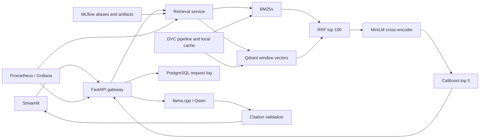

# Ledgerlight

Ledgerlight answers English finance questions using a curated FinRank passage pool, hybrid retrieval, learned reranking, and a local Qwen model. Answers contain request-issued citations with ticker, form, year, and page, or `Not found in sources.` The Streamlit interface provides Ask, expandable Sources, Ranking Trace, and ticker/year/form filters.

The verified local champion is pipeline **7**: tuned BGE-small, tuned MiniLM cross-encoder, and CatBoost YetiRank. Both the frozen TEST retrieval ladder and the 119-question citation proxy run used the **Torch pipeline**. Current serving uses **ORT CUDA, validated on DEV only**; TEST results must not be attributed to ORT. All services use loopback addresses and manual lifecycle commands. The completed stack is left stopped, with persisted stores intact.

## Architecture



Retrieval groups window hits by passage, using maximum window cosine. Production Qdrant queries retain exact search. Filters must match one provenance record; a ticker from one source cannot combine with a year from another. Query-time input accepts question text and optional user filters only. Registered manifests resolve component weights from MLflow; versioned Qdrant collections retain both encoder versions and `ledgerlight-active` points to encoder 2.

The gateway serializes GPU answer requests, logs candidates, stage scores, answer, citations, timings, versions, and failures to PostgreSQL, and rejects unissued citation markers, generated URLs, HTML, and uncited output. Citation validation is mechanical; it does not establish that a cited passage supports every generated claim.

Triton runs in a separate, isolated profile for ONNX dynamic-batching experiments. It is verified but is not in the application's request path. Never run Triton or a GPU benchmark alongside the application GPU services on this 4 GiB device.

## Start and stop

Run commands from the repository root in Bash. The existing environment, local model artifacts, database, and Qdrant stores are retained.

```bash
source scripts/env.sh
ledgerlight start
ledgerlight health
ledgerlight ask "(example question omitted)"
ledgerlight stop
```

`ledgerlight start` invokes Compose, builds the local application image when needed, and waits for gateway and UI health. `ledgerlight stop` sends SIGTERM to the application and optional Triton profile, waits up to 60 seconds for exit, then stops PostgreSQL last in the same way. It never escalates to SIGKILL. It preserves containers, bind-mounted data, images, and caches. Every Compose service uses `restart: "no"`; none starts automatically after reboot.

| Service | Local address |
|---|---|
| Streamlit | http://127.0.0.1:8501 |
| Gateway / health / API schema | http://127.0.0.1:8000/health , http://127.0.0.1:8000/docs |
| Retrieval | http://127.0.0.1:8001/health |
| MLflow | http://127.0.0.1:5000 |
| Qdrant | http://127.0.0.1:6333 |
| llama.cpp | http://127.0.0.1:8091/health |
| Prometheus | http://127.0.0.1:9090 |
| Grafana | http://127.0.0.1:3000/d/ledgerlight-runtime/ledgerlight-runtime |
| PostgreSQL | 127.0.0.1:5433 |
| Optional isolated Triton | HTTP 127.0.0.1:8002, gRPC 127.0.0.1:8003, metrics 127.0.0.1:8004 |

After a cold reboot, the user must check the data SSD mount and manually start Docker. The `sudo systemctl start docker` command below is a **user-executed host command requiring administrative privileges**; the application and project scripts do not execute it. Do not start Docker against an unmounted data path. Continue with the project services only after Docker and the NVIDIA device are available.

```bash
findmnt .
sudo systemctl start docker
docker info --format '{{.DockerRootDir}}'
nvidia-smi
source scripts/env.sh
docker compose up -d postgres
docker compose exec -T postgres pg_isready -h 127.0.0.1 -p 5433 -U ledgerlight
docker compose up -d mlflow qdrant prometheus grafana
curl --fail http://127.0.0.1:5000/health
curl --fail http://127.0.0.1:6333/healthz
ledgerlight start
ledgerlight health
```

Wait for readiness before proceeding if either health command initially fails. The recovered host uses Docker data-root `./docker/engine`; GPU access inside Compose was verified live. This project does not install host packages, alter the Docker daemon, or manage system services.

For a separate fresh workspace with the required Docker/GPU setup, `bash scripts/bootstrap.sh` creates the Python 3.12 uv environment and a private generated `.env`, starts tracking, fetches pinned service/model artifacts, reproduces through evaluation, registers models, and starts the application. This can involve downloads and training; it is not the restart command for the completed workspace. The fresh all-in-one bootstrap was not rerun during recovery. Do not copy placeholder passwords from `.env.example` into a populated database.

## Data, acquisition, and reproducibility

FinRank is acquired from [datanxt/FinRank](https://github.com/datanxt/FinRank/tree/916dc27e77b90e294ea1b3a2cc5b0abcf07392d1), pinned at `916dc27e77b90e294ea1b3a2cc5b0abcf07392d1`. `FinRank.jsonl` is 34,129,228 bytes with SHA256 `e9295f680bd6085362486c90c170bce243be7f85ed18074d6ba21cb75141ac78`. Acquisition checks the digest. The upstream dataset is **CC BY-NC 4.0**; passages and weights are not bundled in Git. There is no configured DVC remote or Git remote. Existing DVC objects remain in the local cache; a fresh clone alone cannot recover unpublished local model artifacts.

The official random split contains 948 TRAIN, 118 DEV, and 119 TEST queries. The pool has 5,230 exact-text passages, 4,796 after whitespace normalization, 2,322 positive occurrences, and 6,021 hard-negative occurrences. Available citation metadata is ticker, year, form, and page. Full company names and source URLs are absent; the application does not invent them.

Pandera validation enforces IDs, nonempty questions/passages, positives, split coverage/disjointness, and a query-only schema. Provenance is preserved: 174 passages have multiple source records and 46 span multiple document metadata combinations. There are 19 stored SHA1 mismatches under the documented stripped-text comparison. The 538 hard negatives positive for another question remain query-specific. Three normalized question strings repeat; **“(example question omitted)” occurs in TRAIN and TEST with different positives**. The official split was retained and this overlap is a limitation.

```bash
source scripts/env.sh
LEDGERLIGHT_RESUME=1 dvc repro evaluate
dvc status
python scripts/leakage_check.py
bash scripts/ci.sh
```

The DVC DAG is ingest → validate → index_bm25 → embed → baselines → train → evaluate. On this completed workspace `dvc repro` reuses unchanged outputs and leaves clean status. The evaluator reuses existing frozen TEST metrics when the training fingerprint matches, and refuses changed training inputs. Never delete the frozen evaluation, force a new TEST evaluation, or use TEST feedback to tune the stack. New serving experiments use DEV and separate evidence files.

`uv.lock`, `params.yaml`, `services.lock.json`, `dvc.lock`, and DVC pointers capture dependencies, pins, and artifacts. All project caches and temporary paths are set inside the workspace by `scripts/env.sh`. `scripts/storage.sh STAGE` records both filesystems and enforces a 20 GiB free-space guard. Scripts do not perform global cleanup.

## Retrieval and training

BM25s uses Lucene IDF, k1=1.5, b=0.75, and lowercase `\w+` tokens. BGE-small uses the model-card query prefix, normalized CLS embeddings, 510 content tokens plus specials, stride 384, and 11,067 windows. RRF k=10 was selected from 10/30/60/100 on DEV. CE depth=50 was selected from 20/50/100; each passage uses its best dense window. The frozen LTR stage scores RRF top-100 candidates using CE features computed for that candidate pool.

| Component | Pin / selected configuration |
|---|---|
| BGE | `BAAI/bge-small-en-v1.5`, revision `5c38ec7c405ec4b44b94cc5a9bb96e735b38267a`; trial 2, lr 2.8231933e-5, one epoch, batch 32, scale 20, two negatives |
| MiniLM CE | `cross-encoder/ms-marco-MiniLM-L6-v2`, revision `233902d25c440f23af6f7d6e94d2946bac0bee0a`; trial 3, lr 9.6359827e-6, two epochs, BF16 training, saved FP32 weights |
| CatBoost | YetiRank trial 26, 500 iterations, depth 6, lr 0.1413028235, L2 1.4815751, CPU training |
| Qwen | `unsloth/Qwen3.5-2B-GGUF`, revision `f6d5376be1edb4d416d56da11e5397a961aca8ae`; `Qwen3.5-2B-Q4_K_M.gguf`, SHA256 `aaf42c8b7c3cab2bf3d69c355048d4a0ee9973d48f16c731c0520ee914699223` |
| llama.cpp | CUDA 12.8 build `b12284`, archive digest in `services.lock.json` |

Training groups normalized questions into partition A (712 queries, neural models only) and B (236 queries, LTR only). BGE uses CachedMultipleNegativesRankingLoss with that query's positives, hard negatives, and mined nonpositives. CE uses supervised query/window pairs from A. Six BGE and six CE configurations completed; CatBoost ran 50 Optuna trials. Trials and seed runs are retained in PostgreSQL-backed MLflow. An interrupted BGE attempt remains KILLED/failed in its tracking records and was requeued with the same configuration.

The leakage audit checks the exact feature contract, poisoned-oracle invariance, partition membership, and 52 serialized CatBoost models. It found no forbidden feature. Labels are used for supervised targets and offline metrics only. The offline row helper constructs an unused target array, but prediction receives only features and group IDs; live serving never loads labels.

| LTR feature | Query-time source |
|---|---|
| `bm25` | Question text and indexed passage text |
| `dense` | Question embedding and maximum passage-window cosine |
| `rrf` | Frozen fusion of lexical/dense ranks |
| `ce` | Question and best dense passage window, raw CE logit |
| `bm25_rank`, `dense_rank`, `rrf_rank`, `ce_rank` | Respective candidate score ordering with stable ties |
| `passage_tokens`, `window_count` | Indexed passage/window offsets and count |
| `query_tokens` | Word count from question text |
| `ticker_match`, `year_match`, `form_match` | Values parsed from question text, compared with passage metadata |

No feature uses qrels, gold answers, gold positives, train-positive popularity, or “was positive in training” priors. User filters restrict eligible sources; metadata matches do not consume dataset query annotations.

Seed 42 was fixed for the frozen ladder; seeds 123 and 2026 quantify variance without choosing a seed on TEST.

| Selected component | DEV nDCG@10 mean (%) | Range (%) |
|---|---:|---:|
| Tuned dense encoder | 31.2912 | 31.1443–31.4242 |
| Tuned CE pipeline | 33.5046 | 32.4278–34.2250 |
| CatBoost pipeline | 39.8239 | 39.1119–40.2641 |

## Frozen retrieval evaluation

All entries use published binary qrels and ranx metrics. Recall is the macro average of each question's fraction of labeled positives retrieved. Values below are percentages. **The choice among many candidates was made on only 118 DEV queries.** TEST was evaluated once for the entire frozen nine-entry ladder, before any serving/backend work.

DEV, n=118:

| Configuration | R@10 | R@20 | R@100 | nDCG@10 | MRR |
|---|---:|---:|---:|---:|---:|
| BM25 | 36.02 | 45.55 | 65.54 | 24.18 | 26.32 |
| BGE | 39.19 | 51.20 | 72.95 | 25.38 | 27.73 |
| RRF | 42.87 | 50.99 | 73.66 | 28.62 | 30.62 |
| CE-zero | 41.45 | 54.66 | 73.66 | 28.32 | 31.36 |
| BGE-ft | 43.50 | 55.51 | 81.29 | 29.48 | 32.42 |
| CE-ft | 52.05 | 63.42 | 81.29 | 33.86 | 33.90 |
| CatBoost | 59.39 | 69.99 | 81.29 | 40.26 | 42.85 |
| BGE-ft-dense | 47.74 | 63.70 | 80.65 | 31.31 | 33.73 |
| RRF-ft | 46.12 | 59.89 | 81.29 | 31.78 | 34.68 |

Frozen TEST, n=119:

| Configuration | R@10 | R@20 | R@100 | nDCG@10 | MRR |
|---|---:|---:|---:|---:|---:|
| BM25 | 37.04 | 44.61 | 65.62 | 22.79 | 22.97 |
| BGE | 33.68 | 48.67 | 66.04 | 21.53 | 22.78 |
| RRF | 42.93 | 53.29 | 70.31 | 25.37 | 24.54 |
| CE-zero | 41.32 | 51.12 | 70.31 | 25.50 | 26.66 |
| BGE-ft | 42.16 | 53.50 | 74.09 | 26.19 | 26.87 |
| CE-ft | 48.25 | 57.84 | 74.09 | 28.47 | 26.52 |
| CatBoost | 52.45 | 60.85 | 74.09 | 34.92 | 36.15 |
| BGE-ft-dense | 47.13 | 55.46 | 74.09 | 28.87 | 29.03 |
| RRF-ft | 46.99 | 60.50 | 74.09 | 29.78 | 30.12 |

`BGE-ft` is the ladder stage with tuned BGE plus RRF plus zero-shot CE; `BGE-ft-dense` is the separate tuned dense-only alternative. `RRF-ft` uses the tuned encoder without CE. CatBoost won on DEV and remains champion regardless of TEST comparisons.

The paired query bootstrap, 10,000 resamples with seed 42, gives final-minus-BM25 nDCG@10 **+12.13 percentage points, 95% interval [6.71, 17.65]**. With 119 TEST queries this interval remains wide. The small-sample random split measures known-document/new-query performance, not transfer to unseen filings.

Negative results are retained: zero-shot CE was below RRF on DEV, and also reduced the tuned-RRF result. Tuned CE improved its direct zero-shot predecessor, but its frozen TEST nDCG was below the tuned dense/RRF alternatives; no post-TEST selection change followed. A single DEV diagnostic reproduced the earlier rank-bm25 reference; canonical BM25s recall differed because of the BM25/IDF variant. BGE matched the earlier windowed reference to within 0.02 percentage points on DEV. No extra TEST diagnostic was run.

Exact results and per-query tables are in `data/evaluation/metrics.json`, `per_query.json`, and the MLflow `frozen-ladder` run. The metrics file SHA256 remains `8895f568f18193c998f050ea39c2c297eaf1ca70d4a4a6500b72d2fe4058d560`.

## Generation measurements and citation proxies

The historical single pass of all 119 TEST questions through `/ask` used pipeline 7 with the Torch retrieval backend. It was not repeated during recovery or after the ORT switch. These are citation/operational proxies, **never answer correctness**.

| Measure | Recorded result |
|---|---:|
| HTTP completions / failures | 119 / 0 |
| Answer with accepted citation | 51/119, 42.86% |
| Cites at least one qrel-positive passage | 20/119, 16.81% |
| Abstention | 68/119, 57.14% |
| Completion limit and no-thinking retry | 35/119, 29.41% |
| E2E p50 / p95 | 10.77 / 22.32 s |
| E2E mean | 12.46 s |
| Sampled total GPU memory peak | 3155.625 MiB, 5 s scrape interval |

Qwen runs with context 8192, thinking enabled, reasoning budget 512, and total completion cap 1024. This llama.cpp build exposed 511 retokenized reasoning tokens at the template boundary in DEV probes; it did not expose an authoritative reasoning-token counter. The gateway retries once without thinking when the completion limit is reached. That fallback's 29.41% historical frequency is a main latency factor; queueing adds further delay under load.

A separate six-request LLM-only DEV streaming probe measured process-cold TTFT 0.611 s and five warm requests with TTFT p50/p95 0.606/0.610 s, first-answer-token p50/p95 5.696/5.715 s, decode median 100.98 tokens/s, E2E p50/p95 8.642/8.667 s, and sampled VRAM peak 3120 MiB. It had zero retries. TTFT includes reasoning; this is not `/ask` TTFT. OS page cache was warm and prompt cache disabled. The cold streaming E2E was 8.565 s.

The live DEV browser flow verified Ask, Sources, Ranking Trace, and ticker/year/form filters, with no JavaScript errors; screenshots remain in `logs/ui-dev.png` and `logs/ui-ranking-dev.png`. A GM incentive question produced an answer citing GM 2025 10-K pages 4–5. This is a demo receipt, not a correctness annotation.

## Model lifecycle and local CI rehearsal

Four registered model names contain 14 versions: pipeline 1–9, encoder 1–2, CE 1–2, and ranker 1. Pipeline `champion` is 7 and `previous` is 1. Encoder champion is 2, CE champion is 2, and ranker champion is 1.

Promotion accepts only a finite full-pipeline DEV nDCG@10 at least as high as the current champion, retains `previous`, and updates component aliases. Rollback explicitly restores the prior version. Health receipts and live searches/answers verified two servable versions:

| Lifecycle receipt | Live pipeline version |
|---|---:|
| Before promotion | 1 |
| Promote selected model | 7 |
| Rollback | 1 |
| Restore | 7 |

`data/serving/lifecycle.json` retains the health, search, answer, and CLI receipts. Promotion of version 1 from champion 7 was correctly rejected. To exercise the local loop from the final state and restore champion 7:

```bash
source scripts/env.sh
ledgerlight health
ledgerlight rollback
ledgerlight health
ledgerlight promote 7
ledgerlight health
```

`.github/workflows/ci.yml` runs `bash scripts/ci.sh`: Ruff, formatting, pytest, the static forbidden-feature gate, and a CPU DVC pipeline using an eight-query/sixteen-passage self-authored FinRank-schema fixture. Pytest includes the promotion gate, schema rejection cases, oracle-field rejection, citation enforcement, and provenance filter behavior. The equivalent workflow was executed locally. No hosted GitHub Actions workflow ran: there is no remote or hosted CI/CD deployment. This is a local lifecycle rehearsal, not production MLOps or a claim to Google MLOps level 1 or 2.

## ONNX, Triton, and serving parity

Selected encoder and CE graphs and both registered component versions were exported to ONNX, opset 17, FP32. All six graph files pass ONNX checking. Numerical checks use atol 1e-4 and rtol 1e-3. The table reports median milliseconds for 512 real financial tokens, three warmups and 20 repetitions, eight CPU threads, transfer included and tokenization excluded, TF32 disabled.

| Model / batch | Torch CPU | ORT CPU | Torch CUDA | ORT CUDA |
|---|---:|---:|---:|---:|
| BGE / 1 | 135.59 | 76.10 | 17.06 | 15.43 |
| BGE / 8 | 1437.32 | 703.39 | 128.88 | 118.33 |
| MiniLM CE / 1 | 70.84 | 42.56 | 9.49 | 7.85 |
| MiniLM CE / 8 | 780.51 | 365.05 | 64.71 | 59.40 |

Full DEV ranking validation on CPU and CUDA retained every aggregate retrieval metric, including nDCG@10 40.2641%. CPU exact top-20 order matched 118/118 queries; CUDA matched 117/118, with 100% top-20 set overlap. Ranking uses the frozen Torch window index, as serving does. CUDA also checked all 11,067 re-embedded windows, maximum absolute error 3.87e-7; CPU window numerical checks cover batches 1 and 8.

The original CE batch-32 attempt exceeded the configured **1 GiB ORT arena**, requesting 402,653,184 bytes with approximately 75 MB left. This was an isolated allocator-limit failure, not contention with another GPU service. The FAILED MLflow run and log are retained; CE inference is capped at batch 8. Completed timing cells were reused when validation resumed.

The live ORT CUDA `/search` DEV probe matched 19/20 exact orders and 99.75% top-20 overlap. Paired R@10, R@20, nDCG@10, and MRR within the returned top-20 lists were unchanged. A tiny numeric difference affected a cutoff/order; this is recorded rather than described as bit-exact serving. The frozen TEST result and prompt remain unchanged.

Isolated Triton ONNX Runtime CUDA serving was verified with the retained `26.01-py3` image, maximum batch 8, preferred batches 4/8 and 2000 μs queue delay. Both models passed numerical parity and each coalesced 32 concurrent batch-1 requests into **five executions, mean batch 6.4**. Total GPU memory after the run was 1773 MiB. HTTP round-trip median/p95 milliseconds:

| Model / batch | Triton HTTP p50 | p95 |
|---|---:|---:|
| BGE / 1 | 18.34 | 20.09 |
| BGE / 8 | 118.45 | 119.51 |
| CE / 1 | 10.30 | 10.64 |
| CE / 8 | 60.20 | 60.34 |

HTTP overhead makes these different from the model-only ORT comparison. Triton fits alone and was stopped before application serving resumed. TensorRT conversion was not attempted; the bounded experiment verified the required ONNX backend and dynamic batching without adding another GPU runtime to the application.

The following commands rerun DEV backend experiments, not TEST. Full CPU DEV validation is substantially slower than the small timing cells; run GPU work sequentially. Existing evidence remains in DVC and MLflow.

```bash
source scripts/env.sh
docker compose stop --timeout 30 llama retrieval
python scripts/backend_check.py
CUDA_VISIBLE_DEVICES='' python scripts/export_components.py
python scripts/prepare_triton.py
docker compose -f compose.yaml -f compose.triton.yaml --profile triton up -d triton
CUDA_VISIBLE_DEVICES='' python scripts/triton_check.py
docker compose -f compose.yaml -f compose.triton.yaml --profile triton stop --timeout 30 triton
ledgerlight start
```

Results: `data/serving/backends.json`, `onnx_components.json`, `triton.json`, and `ranking_parity-ort-cuda.json`. Timing cache reuse is explicit in the comparison script and retained evidence; these are measurements from this machine, not hardware-independent promises.

## ANN comparisons

Twenty-five fixed DEV query vectors were compared at grouped parent top-20, including payload filters. Qdrant approximate queries use ef=64; its planner may choose full scans for selective filters. Thus `exact=False` does not prove HNSW execution for every filtered request. The trained collection contains 11,067 indexed windows.

| Filter | Eligible windows | Qdrant overlap (%) | Exact p50 ms | Approx p50 ms | pgvector overlap (%) | pgvector exact / HNSW p50 ms |
|---|---:|---:|---:|---:|---:|---:|
| None | 11067 | 99.60 | 4.27 | 2.71 | 99.60 | 4.40 / 1.80 |
| 10-K | 9232 | 99.00 | 14.58 | 5.28 | 99.40 | 10.19 / 2.46 |
| JNJ | 556 | 99.80 | 3.35 | 3.25 | 97.60 | 7.35 / 19.41 |
| JNJ, 2025 | 327 | 100.00 | 3.28 | 3.22 | 96.40 | 7.10 / 24.68 |
| 2022 | 18 | 100.00 | 1.69 | 1.59 | 98.93 | 6.96 / 24.52 |

Optional pgvector was inexpensive enough to run. EXPLAIN verified its HNSW index; m=16, ef_construction=100, ef_search=128, strict iterative scan, and top-400 window oversampling precede parent grouping. Its exact reference scans all eligible parents. Selective-filter HNSW was slower and lost more neighbors, a retained negative result. Neither ANN experiment changed production retrieval.

```bash
source scripts/env.sh
python scripts/vector_check.py
python scripts/pgvector_check.py
```

Full p50/p95 and protocols are in `data/serving/vector_search.json` and `pgvector.json`. Overlap is agreement with exact retrieval, not relevance or answer accuracy.

## Observability and DEV load

Prometheus scrapes gateway, retrieval, Qdrant, llama.cpp, and isolated Triton while each is running. Grafana provisions ten panels for request rate, errors, abstentions, E2E p50/p95, gateway stages, retrieval stages, RSS, CPU, GPU memory, and scrape availability. Live traffic, metric queries, dashboard API, and dashboard page were verified. GPU targets were verified in separate phases, not all concurrently.

Locust used independently scheduled DEV-only HTTP arrivals, one process-cold request followed by 12 warm requests at 0.1 offered requests/s. Warm median/p95 were 20.12/24.44 s, four requests retried without thinking, and queueing contributed substantially. Cold means first inference after service restart, excludes startup, and retains warm OS page cache. This is a **small DEV sanity run, not a throughput or capacity benchmark or an SLA claim**. The observed completion rate below includes the drain period and does not estimate sustainable throughput.

| Measure | Result |
|---|---:|
| Cold offered / completed / failed | 1 / 1 / 0 |
| Cold E2E | 8.407 s |
| Warm offered / completed / failed | 12 / 12 / 0 |
| Warm wall time, including drain | 134.238 s |
| Observed completions / drained wall time | 0.0894 requests/s |
| Warm E2E p50 / p95 | 20.122 / 24.443 s |
| Warm no-thinking retry | 4/12, 33.33% |
| Locust total requests / failures | 13 / 0 |

Warm server-stage p50/p95 seconds:

| Stage | p50 | p95 |
|---|---:|---:|
| Queue | 8.617 | 13.641 |
| Retrieval, gateway wall time | 0.848 | 0.861 |
| Query embedding | 0.0045 | 0.0065 |
| Qdrant | 0.0096 | 0.0104 |
| CE | 0.809 | 0.822 |
| LTR | 0.0017 | 0.0021 |
| Generation, including retry when used | 8.850 | 17.191 |

The cold request had no retry; its retrieval/generation were 0.928/7.444 s. A single cold request has no meaningful latency distribution. Quantiles across separate stages do not add to E2E quantiles. Warm queueing reflects serialized generation and the retry path, consistent with the separate historical 29.41% TEST retry proxy. The DEV warm retry rate is a different sample and does not replace that frozen measurement.

`sql/` contains failure, abstention, empty-retrieval, and stage-latency slices. Executed PostgreSQL results show two validation errors from deliberate oracle-field probes and the intentional impossible-filter empty result; there were no load-test failures. Backend grouping separates historical Torch records from ORT traffic, but these mixed query samples are not a controlled backend E2E comparison.

```bash
source scripts/env.sh
python scripts/load_check.py
python scripts/sql_check.py
```

For a cold rerun, stop/restart retrieval and llama and wait for health before the load script; do not send an inference warmup. `data/serving/load.json`, `sql_slices.json`, and `observability.json` retain the complete measurements. The load script itself does not restart services.

## Recovery, failures, and limits

Recovery followed a full machine power-off/reboot. The pause had not produced an S6 commit, and MLflow's old container had exit code 137. PostgreSQL's startup log reported a clean prior database shutdown; there was no evidence of corruption or lost history. Recovery found 120 runs, all 114 migration-era run IDs, four registered names, 14 versions, and champion 7. Qdrant collections and alias, backup, six ONNX graphs, frozen TEST checksum, config, and prompt were intact. No RUNNING run, held stale DVC lock, truncated JSON, or half-written ONNX artifact was found; no lock or useful artifact was removed.

The old MLflow CLI PID 1 lacked a SIGTERM handler. A project-local process-group supervisor was added and a live stop returned exit 0 with the worker group reaped. The final stop uses that verified shutdown path. The unrelated user-owned `mlflow mcp run` processes were left untouched. S6 added five finished experiment runs, giving 125 total before final packaging, with the previous failed/interrupted runs retained.

Other retained failures include an initial model registration rejected because Hugging Face snapshot symlinks resolved outside MLflow's artifact directory; materializing the files fixed registration. The interrupted BGE attempt, the 1 GiB ORT arena failure, an initial Streamlit session-state/form-key collision, and a browser readiness race are also retained. The product bugs were fixed with DEV probes. The official GGUF endpoint returned HTTP 401; the pinned Unsloth artifact was used. No extra sweeps, labels, LLM judges, TEST tuning, or TEST reruns were introduced.

Two boundary deviations occurred earlier and remain disclosed. Initial NVIDIA catalog discovery and an MLflow artifact helper used default `/tmp` scratch before all temporary paths were redirected; disposable scratch was cleaned by those tools. Later scoped audits found no project-named `/tmp` entries or open project temporary files outside the workspace. Once, a process listing exposed the generated local database password in tool output. It was rotated, and a saved audit verified the retired credential was rejected. Current scans found no credential in Git history, DVC artifacts, MLflow artifacts, logs, or project process arguments. The backup is gitignored and mode 0600. Tool conversation history cannot be rewritten; these scans do not retract that exposure.

This is a local, unauthenticated loopback demo. The curated FinRank pool is not all of EDGAR; published qrels are incomplete supervision. Evaluation covers known documents and new questions, includes one repeated cross-split question, and has substantial uncertainty at TEST n=119 and DEV n=118. Citation presence, citation/qrel overlap, abstention, and retry rates are proxies. No human annotation, answer-correctness evaluation, unseen-document transfer claim, production SLA, or MLOps maturity level is provided.

The final local rehearsal passed Ruff, formatting, 11 pytest tests, and the CPU fixture/schema/model gates; four nonblocking MLflow type-hint warnings remain. Verification also checks DVC status/reproduction, scoped temporary-file and secret checks, registry aliases, and clean Compose shutdown. Stores, DB backup, Triton image, and the user's Ubuntu image are preserved. Git has no remote. The user still starts Docker manually after reboot, chooses the code license considering the data's CC BY-NC restriction, creates the GitHub repository and pushes when ready, and records the demo video. Public renaming is a separate later task; the current internal name remains `ledgerlight`. No LICENSE or video is created here.
